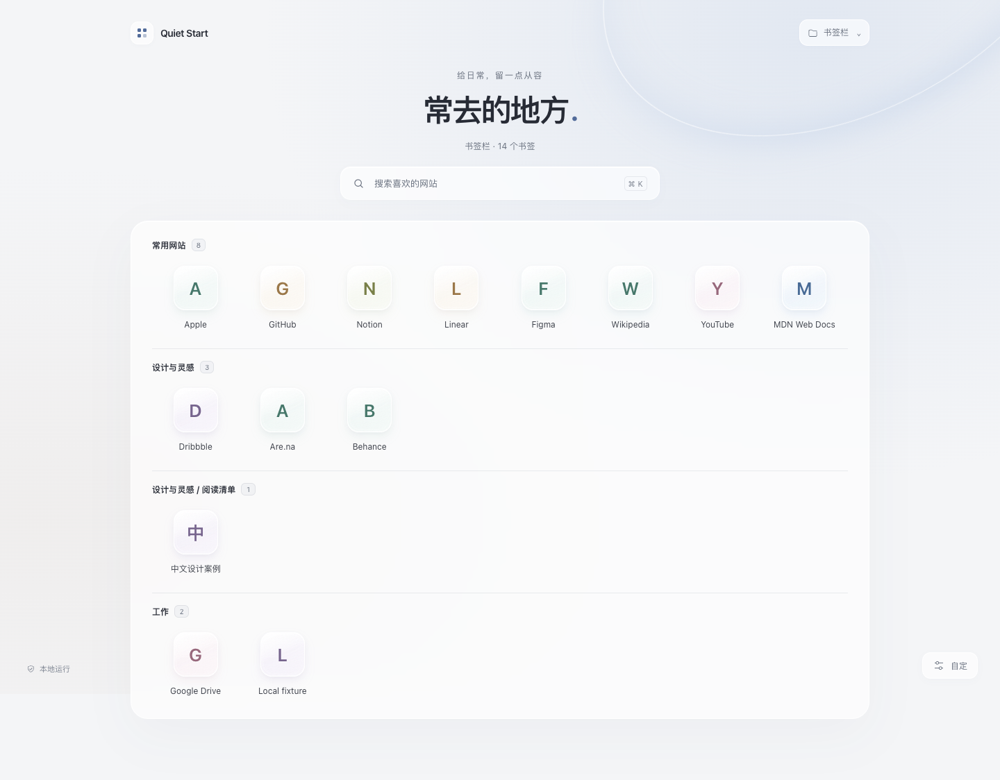

# Quiet Start · 收藏夹起始页

一个完全本地运行的 Chrome Manifest V3 扩展，将新标签页替换成雾白与石墨配色、轻玻璃图标风格的收藏夹网格。使用原生 HTML、CSS、JavaScript，安装不需要 Node、构建或联网。



[深色预览](docs/screenshots/dark.png) · [设置面板](docs/screenshots/settings.png) · [测试记录](docs/VERIFICATION.md)

## v1.2.0 更新

- 全新 Air 设计：雾白浅色、石墨深色，配少量冰蓝与银色高光。
- 居中搜索与清晰的标题层级，分组收藏夹收纳在半透明面板中。
- 图标采用更轻的玻璃材质；网站图标使用中性浅色底板，保持深色模式下的辨识度。
- 右上角直接下拉切换收藏夹并保存；右下角继续提供完整设置。
- 不增加权限，不引入外部图片、脚本或运行时依赖。

## Mac Chrome 快速安装

1. 从 [Releases](https://github.com/ItsCh1pmunk/quiet-start/releases/latest) 下载 `quiet-start-1.2.0.zip`，解压到长期保留的位置，例如 `文稿/Chrome 扩展/quiet-start`。也可以使用 GitHub 的 Code → Download ZIP，或直接克隆本仓库。
2. 在 Chrome 地址栏输入 `chrome://extensions` 并回车。
3. 打开页面右上角的「开发者模式」。
4. 点击「加载已解压的扩展程序」，选择 **直接包含 `manifest.json` 的文件夹**。Release 包中为 `quiet-start`；GitHub 源码 ZIP 通常为 `quiet-start-main`。不要选 ZIP 文件。
5. 按 `⌘ T` 打开新标签页。如果 Chrome 询问是否保留此新标签页更改，选择保留。

详细步骤、更新和卸载见 [Mac 安装教程](docs/INSTALL-MAC.md)。

## 功能与用法

- 默认读取 Chrome 书签栏。在右上角直接下拉选择任何书签文件夹，也可选「全部书签」；选择后即时切换并自动保存。右下角「自定起始页」仍提供完整设置。
- 自动响应新增、删除、重命名、移动、重新排序与导入书签。每次打开新标签页都会重新读取最新书签；没有后台进程。
- 默认开启「按文件夹分组」，递归展示所选文件夹的全部书签，并用相对路径区分深层和同名文件夹。空文件夹不生成空分组。
- 关闭分组后，显示直属网站与文件夹磁贴。点击文件夹进入，使用上方路径返回；临时导航不改变默认来源。要永久改来源，请在设置中选择。
- 图标大小可调 40–88 px；每行数量可调 4–12 个。窗口不足以容纳时自动减少列数，因此较大的图标和较多列数不一定能同时显示。
- 搜索在本机匹配当前文件夹及其子文件夹的网站名称和网址。`⌘ K` / `Ctrl K` 聚焦搜索，`Esc` 清空搜索；设置面板中 `Esc` 关闭面板。
- 单击书签在当前标签页打开；`⌘` 单击、中键、右键菜单遵循 Chrome 标准链接行为。
- 随 macOS / Chrome 的 `prefers-color-scheme` 自动切换浅色与深色，无需重新打开页面。Chrome 的主题或外观偏好可能覆盖系统选择。
- 开启「仅使用字母图标」后，不读取网站 favicon，只显示由名称生成的本地图标。
- 设置自动保存在本机，多个新标签页共享设置。恢复默认只重置此扩展设置，不改动 Chrome 书签。

## 权限说明

| 权限 / 声明 | 必要原因 | 实际行为 |
| --- | --- | --- |
| `bookmarks` | 读取书签树、文件夹和变化事件 | Chrome 将此权限统一描述为可读取和更改书签；运行时代码只读，不新增、移动或删除书签。Chrome 没有单独的只读书签权限。 |
| `storage` | 保存来源文件夹、图标大小、列数、分组和字母模式 | 仅调用 `chrome.storage.local`，不使用 `storage.sync`。不保存书签副本。 |
| `favicon` | 通过扩展内部 `/_favicon/` 接口获取 Chrome 提供的网站图标 | 仅为 HTTP/HTTPS 书签请求图标，不使用 Google、DuckDuckGo 等第三方图标服务。开启字母模式后不读取。 |
| `chrome_url_overrides.newtab` | 将新标签页指向扩展内的 HTML | 这是清单声明，不是另一个 API 权限。Chrome 可能单独提示新标签页已更改。 |

不申请 `tabs`、`history`、`activeTab`、网站主机权限或 `<all_urls>`；不注入网页，也不公开 favicon 为 web accessible resources。

## 图标和隐私边界

扩展不包含后端、账号、遥测、统计 SDK、外部字体、远程脚本、搜索服务或自动网络请求。页面 CSP 禁止 `fetch` / XHR / WebSocket 等网络连接，并将图片限制为扩展自身来源。所有显示数据均来自本机 Chrome API；书签标题以文本创建，不作为 HTML 执行。

图标读取地址类似 `chrome-extension://扩展ID/_favicon/?pageUrl=…&size=64`。网址作为参数传给 **本机 Chrome 内部接口**，不是发给图标网站。没有缓存时 Chrome 可能返回通用图标；读取失败或非网页链接显示字母图标。不会为了高清图标自动访问书签网站。由于 Chrome 缓存图标分辨率有限，部分图标可能较模糊。

「本地运行」指此扩展的数据处理和设置保存。Chrome 自身的书签同步、浏览器遥测或后台联网仍由你的 Chrome 设置控制；此扩展不会关闭或启用它们。点击一个书签会正常访问对应网站，这与起始页本身的数据处理不同。希望完全不读取浏览器网站图标时，可开启字母模式。

安全起见，`javascript:`、`data:`、`file:`、无法解析及其他未允许协议的书签不展示。支持 HTTP、HTTPS、Chrome 内部地址、扩展地址、mailto 和 FTP；最终能否打开仍由 Chrome 与操作系统决定。当前版本不提供编辑、拖动排序、壁纸或外部搜索框；书签管理继续使用 Chrome 的书签管理器。

## 目录与开发检查

```text
quiet-start/
├── manifest.json
├── newtab.html
├── styles.css
├── src/app.js              # Chrome API、事件、界面与设置
├── src/model.js            # 书签树、分组、过滤和参数验证
├── assets/icon-*.png
├── tests/model.test.js     # Node 内置测试，无额外依赖
├── tests/browser.test.cjs  # 真实 MV3 扩展集成测试
└── docs/                  # 安装、验收记录及截图
```

只修改 HTML / CSS / JS 即可。修改后在 `chrome://extensions` 点击扩展卡片的重新加载，再开一个新标签页。代码不需要打包，项目不存在运行时 npm 依赖。

基础测试（Node 18+）：

```sh
cd /你的路径/quiet-start
npm test
```

浏览器集成测试额外需要开发工具 Playwright，**安装和日常使用扩展不需要它**：

```sh
npm install --no-save --package-lock=false playwright@1.62.1
npx playwright install chromium
node tests/browser.test.cjs
```

测试在临时 Chromium 配置中创建人工书签，结束后清理该配置；不连接你的日常 Chrome 配置。会启动本机临时 HTTP 图标测试服务、生成截图到 `docs/screenshots/`。浏览器测试结果与覆盖范围见 [验收记录](docs/VERIFICATION.md)。

## 开源复用评估

检查了 [serbanghita/newtab-bookmarks-extension](https://github.com/serbanghita/newtab-bookmarks-extension) 的 README、Manifest 和 package.json。它提供相近的书签新标签页功能，MIT 许可，但使用 TypeScript / esbuild，并带有本项目不需要的弹出页和公开 favicon 资源声明。为保持原生、零构建及更小的权限表面，本项目独立实现，没有复制第三方项目代码或素材。

API 依据：[Chrome 书签 API](https://developer.chrome.com/docs/extensions/reference/api/bookmarks)、[MV3 favicon 官方用法](https://developer.chrome.com/docs/extensions/how-to/ui/favicons)、[权限清单](https://developer.chrome.com/docs/extensions/reference/permissions-list)。

项目代码采用 [MIT 许可证](LICENSE)。本项目与 Apple、Safari 或 Google 无关联。
